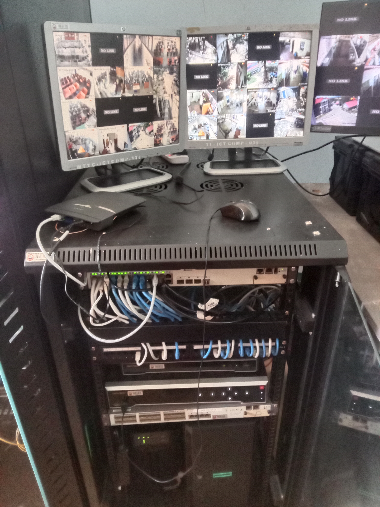
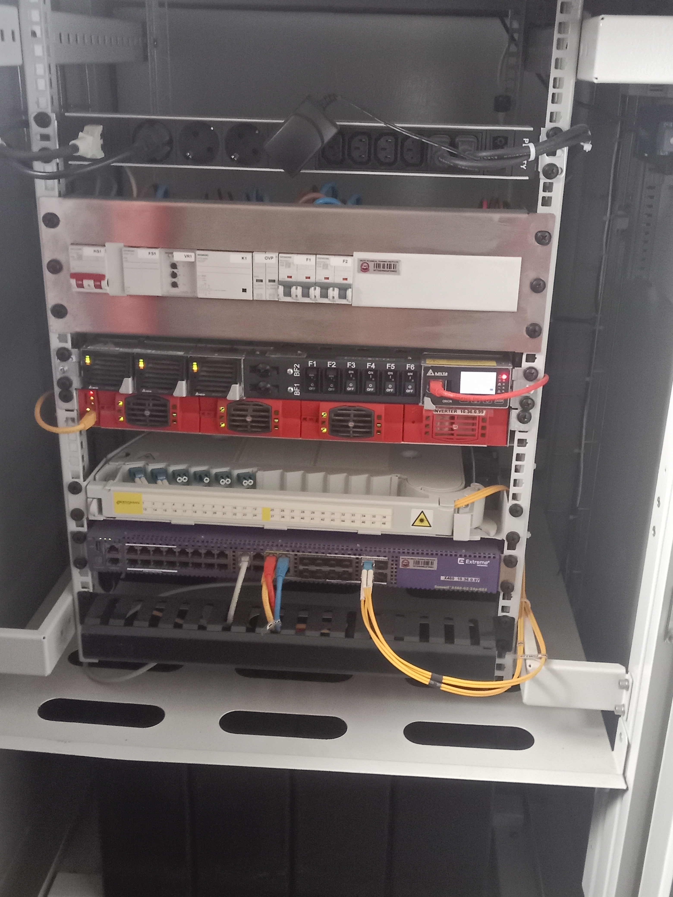
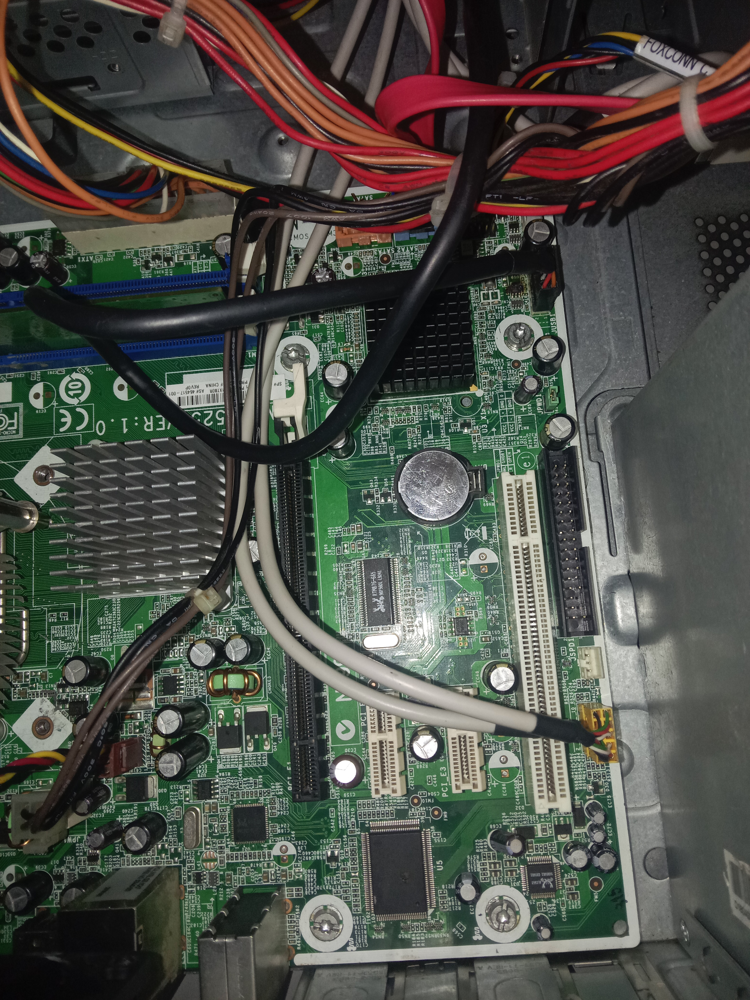
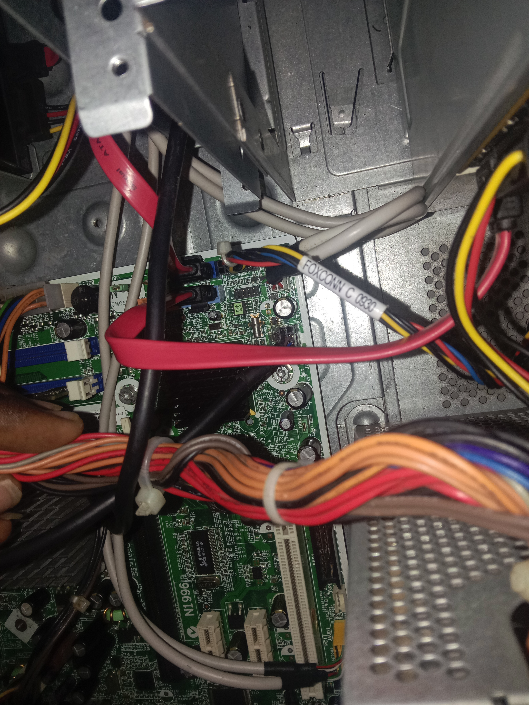
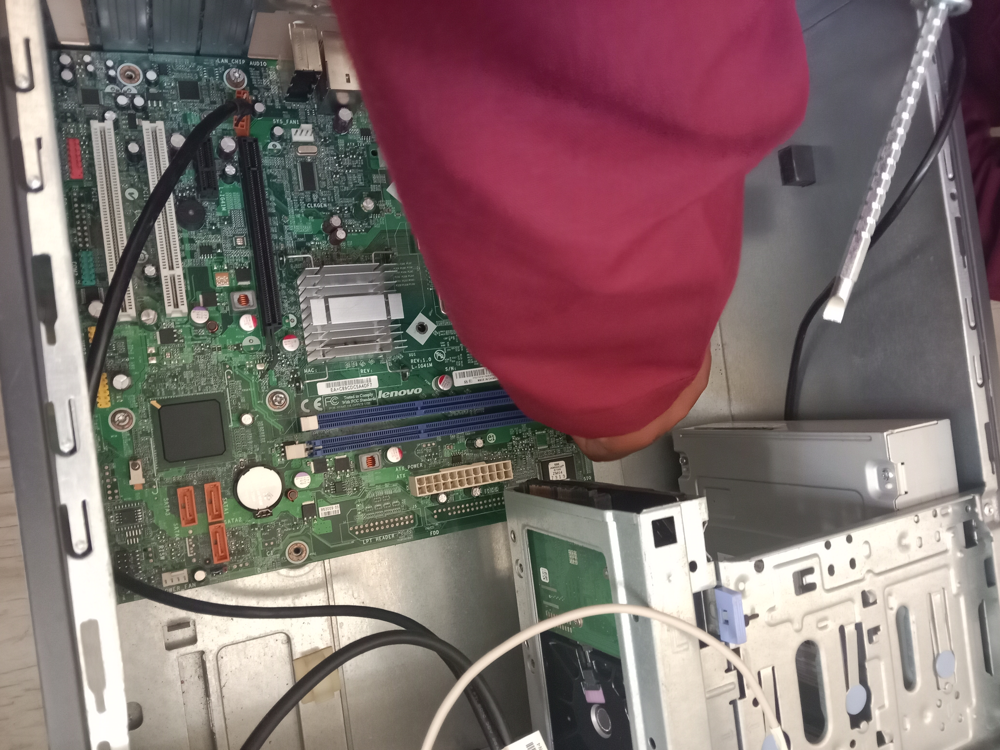
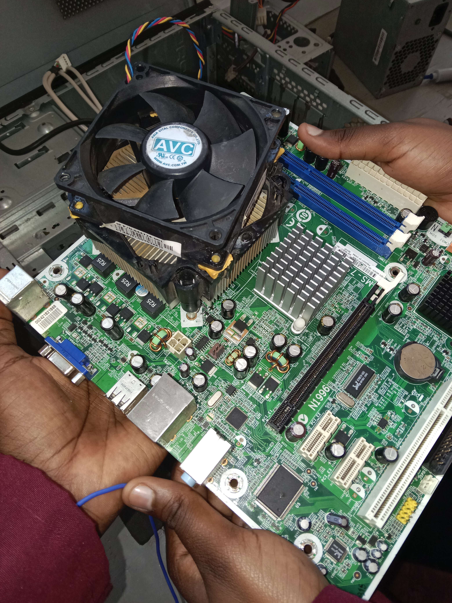
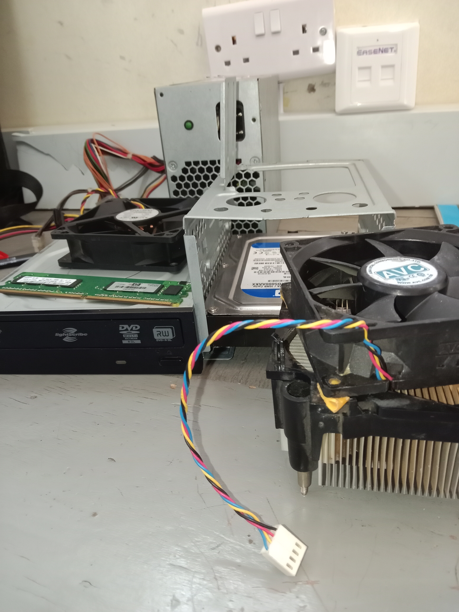
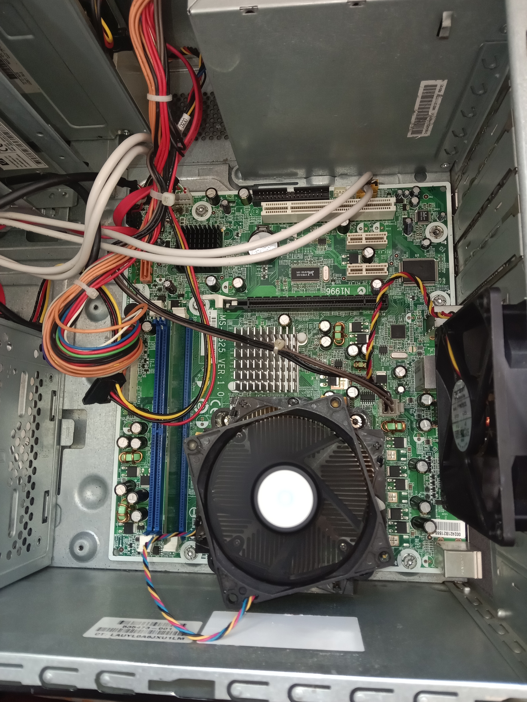

# Hi, I'm Mbogo Ezra Ndichu 👋
**Network & Cybersecurity Student | System & Network Administration**

📍 Wote, Kenya  
🔗 [TryHackMe](https://tryhackme.com) | [GitHub](https://github.com/ezrandichu)  

---

## 🛡️ About Me
I am a Network and System Administration student specializing in Cybersecurity at Wote Technical Training Institute. Passionate about network security, system administration, threat analysis, and hands-on lab environments.

---

## 🛠️ Technical Toolkit
* **Networking & Protocols:** TCP/IP, OSI Model, Subnetting, DNS, DHCP, Wireshark
* **Security & Reconnaissance:** Nmap, Zenmap, TryHackMe Labs, Linux Terminal
* **Operating Systems & Virtualization:** Linux (Ubuntu/Debian), Windows, VirtualBox
* **Content Creation & Tools:** CapCut, DaVinci Resolve, OBS Studio, Git/GitHub

---

## 🧪 Practical Labs & Write-ups

### 1. Local Network Scanning & Enumeration
* **Objective:** Scan local network subnets to identify live hosts, exposed ports, and active services.
* **Tools Used:** Nmap, Zenmap, VirtualBox.
* **Key Steps:** Executed SYN scans (`-sS`), OS detection (`-O`), and service version audits (`-sV`).

### 2. TryHackMe Cybersecurity Learning Paths
* Active learning and hands-on lab completion focusing on Network Fundamentals, Linux CLI, and Web Security.

---

## 📜 Education & Training
* **Diploma in Network & System Administration (Cyber Security)**  
  *Wote Technical Training Institute*

---

## 📫 Connect With Me
* **GitHub:** [github.com/ezrandichu](https://github.com/ezrandichu)
---

## 🖥️ Server Room Infrastructure Visit

Stepping into a server room for the first time is a real eye-opener for any aspiring network administrator. It's where the digital world comes to life, revealing the heart of enterprise infrastructure. We got to see the physical servers humming along, neatly organized with structured cabling that ensures optimal airflow and cooling. Reliability is key, so seeing the robust power backups in place was a great reminder of how we keep systems running no matter what. We also dove into network security, examining how enterprise firewalls are set up and how they filter incoming traffic to keep the network secure.

### 📸 Photos from the Visit:

---

## 🛠️ Computer Hardware, Repair & Maintenance Practical

Hands-on experience in computer hardware maintenance and troubleshooting is essential for any system administrator. During this practical lab, we focused on diagnostic procedures, system disassembly, component identification, and preventive maintenance. 

**Key Highlights:**
* **Safety & ESD Protocols:** Applied strict Electrostatic Discharge (ESD) safety practices before opening system towers.
* **Component Identification & Inspection:** Disassembled towers to inspect critical components including the motherboard, CPU, RAM modules, power supply units (PSU), and storage drives.
* **Preventive Maintenance:** Performed deep cleaning of dust and debris, inspected cooling fans, and replaced degraded thermal paste to maintain optimal thermal performance.
* **Assembly & Diagnostics:** Reassembled hardware units carefully and executed post-assembly boot tests to verify system stability and functionality.

### 📸 Photos from the Practical:

## 🛡️ Cyber Week Awareness Training — Ministry of Education & MICDE

I was honored to attend and represent my institution at the official Cyber Week Awareness Training, organized by the State Department for TVET and the Ministry of Information, Communications and the Digital Economy (Directorate of ICT Security & Audit Control).

---

### 📊 Key Technical Insights & Takeaways

#### 1. Kenya's Cyber Threat Landscape (KE-CIRT/CC Data)
* **11.12 Billion Total Threat Events** recorded up to June 2026, representing a 29% increase year-over-year.
* **4.56 Billion Peak Quarter (Oct–Dec 2025)**: Driven by weak patching, low phishing awareness, and AI-enabled cybercrime.
* **2.36 Billion Threats in Q2 2026**: Equating to approximately 18,000 threat events detected per minute.
* **Primary Threat Vectors**: Ransomware, Phishing, DoS/DDoS, Email Compromise, Data Breaches, Insider Threats, and AI Cybercrime (including deepfakes and automated attacks).

#### 2. The AI Cybersecurity Equation (Huawei Framework)
* **AI for Attackers**:
  * Automated reconnaissance and more convincing phishing.
  * Scaled social engineering and deepfake impersonation.
  * Faster attack development and adaptable malicious content.
* **AI for Defenders**:
  * Threat detection and anomaly identification.
  * Security analytics and investigation support.
  * Automation, incident response, and pattern recognition.

#### 3. Personal Security Practices & Fundamentals
* **Account Protection**: Implementing strong, unique passwords, 2-Step Verification (2SV), and avoiding insecure public Wi-Fi.
* **Phishing Mitigation**: Utilizing the **Stop ➔ Think ➔ Check ➔ Act** framework.
* **Digital Footprint Awareness**: Safeguarding online reputation under the principle that "what goes online stays online".
* **CIA Triad Core Objectives**: Confidentiality, Integrity, and Availability.
* **Extended Detection and Response (XDR)**: Malware and threat detection, monitoring suspicious activity, and vulnerability management.

---

### 🎓 Huawei Certification & Competition Pathways

#### Certification Tiers
* **HCIA** (Huawei Certified ICT Associate)
* **HCIP** (Huawei Certified ICT Professional)
* **HCIE** (Huawei Certified ICT Expert)
* **Core Tracks**: Datacom, Security, Cloud, AI, openEuler, Storage, and 5G.

#### Huawei ICT Competition
* **Tracks**: Practice Competition (Network, Cloud, Computing) and Innovation Competition (AI Innovation).
* **Progression Pipeline**: Registration ➔ Preliminary Rounds ➔ National Final ➔ Regional Final (South Africa) ➔ Global Final (China).

---

### 🚀 Building Kenya's Next Cyber Defenders
* Core institutional focus areas include innovation, research, responsible technology use, ethical hacking competitions, and campus cybersecurity clubs.
* 
