# Hi, I'm Mbogo Ezra Ndichu 👋
**Network & Cybersecurity Student | System & Network Administration**

📍 Wote, Kenya  
🔗 [TryHackMe](https://tryhackme.com) | [GitHub](https://github.com/ezrandichu)  

---

## 🛡️ About Me
I am a Network and System Administration student specializing in Cybersecurity at Wote Technical Training Institute. Passionate about network security, system administration, threat analysis, and hands-on lab environments.

---

## 🛠️ Technical Toolkit
* **Networking & Protocols:** TCP/IP, OSI Model, Subnetting, DNS, DHCP, Wireshark
* **Security & Reconnaissance:** Nmap, Zenmap, TryHackMe Labs, Linux Terminal
* **Operating Systems & Virtualization:** Linux (Ubuntu/Debian), Windows, VirtualBox
* **Content Creation & Tools:** CapCut, DaVinci Resolve, OBS Studio, Git/GitHub

---

## 🧪 Practical Labs & Write-ups

### 1. Local Network Scanning & Enumeration
* **Objective:** Scan local network subnets to identify live hosts, exposed ports, and active services.
* **Tools Used:** Nmap, Zenmap, VirtualBox.
* **Key Steps:** Executed SYN scans (`-sS`), OS detection (`-O`), and service version audits (`-sV`).

### 2. TryHackMe Cybersecurity Learning Paths
* Active learning and hands-on lab completion focusing on Network Fundamentals, Linux CLI, and Web Security.

---

## 📜 Education & Training
* **Diploma in Network & System Administration (Cyber Security)**  
  *Wote Technical Training Institute*

---

## 📫 Connect With Me
* **GitHub:** [github.com/ezrandichu](https://github.com/ezrandichu)
---

## 🖥️ Server Room Infrastructure Visit 001

Stepping into a server room for the first time is a real eye-opener for any aspiring network administrator. It's where the digital world comes to life, revealing the heart of enterprise infrastructure. We got to see the physical servers humming along, neatly organized with structured cabling that ensures optimal airflow and cooling. Reliability is key, so seeing the robust power backups in place was a great reminder of how we keep systems running no matter what. We also dove into network security, examining how enterprise firewalls are set up and how they filter incoming traffic to keep the network secure.

### 📸 Photos from the Visit:
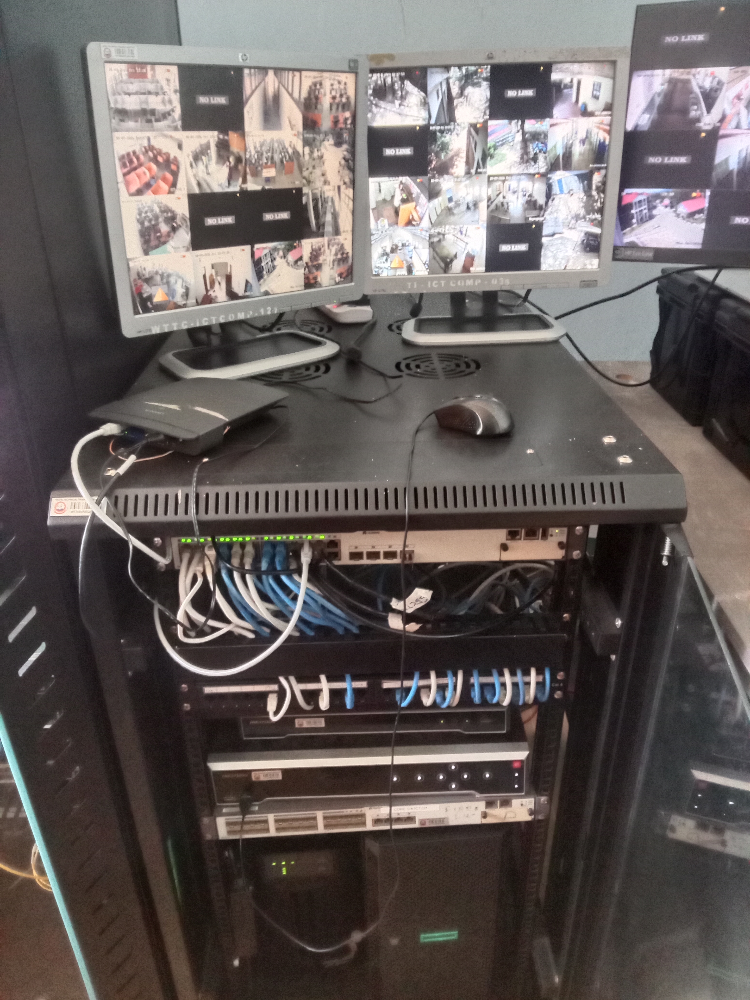
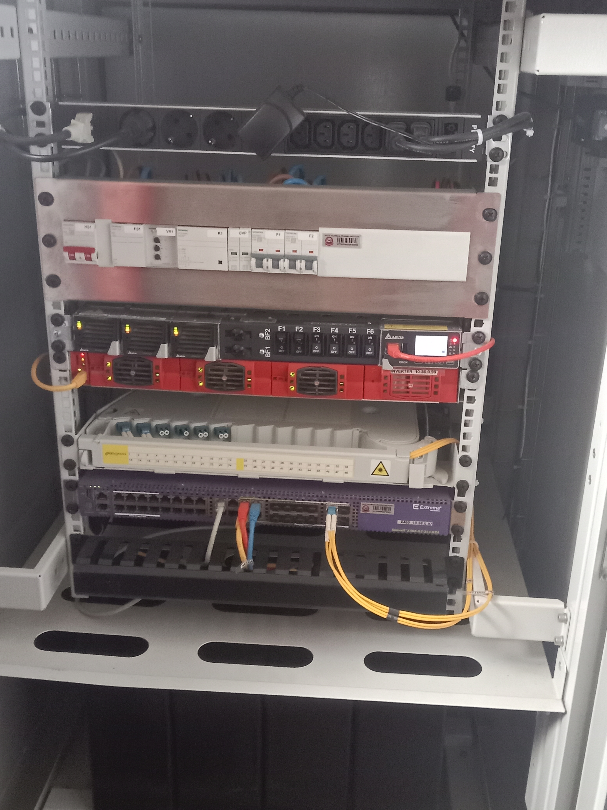
---

## 🛠️ Computer Hardware, Repair & Maintenance Practical 001

Hands-on experience in computer hardware maintenance and troubleshooting is essential for any system administrator. During this practical lab, we focused on diagnostic procedures, system disassembly, component identification, and preventive maintenance. 

**Key Highlights:**
* **Safety & ESD Protocols:** Applied strict Electrostatic Discharge (ESD) safety practices before opening system towers.
* **Component Identification & Inspection:** Disassembled towers to inspect critical components including the motherboard, CPU, RAM modules, power supply units (PSU), and storage drives.
* **Preventive Maintenance:** Performed deep cleaning of dust and debris, inspected cooling fans, and replaced degraded thermal paste to maintain optimal thermal performance.
* **Assembly & Diagnostics:** Reassembled hardware units carefully and executed post-assembly boot tests to verify system stability and functionality.

### 📸 Photos from the Practical:
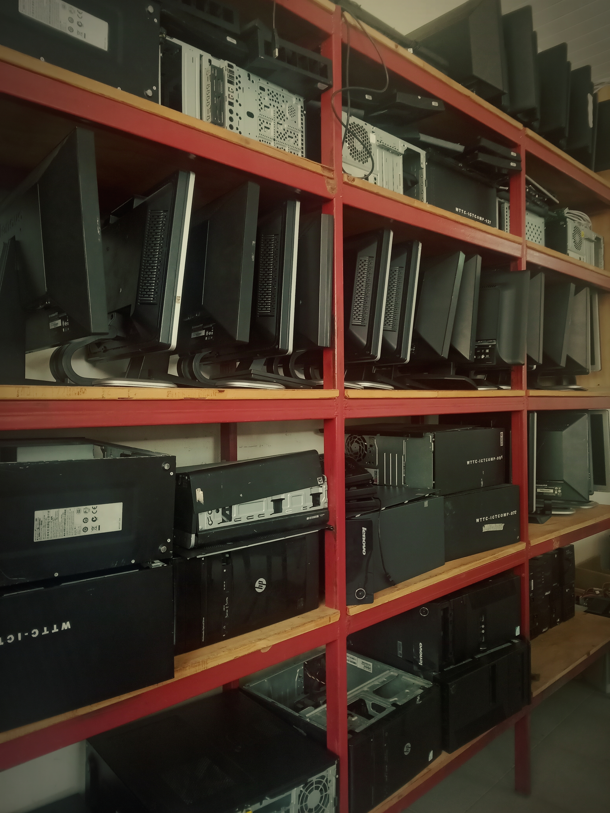
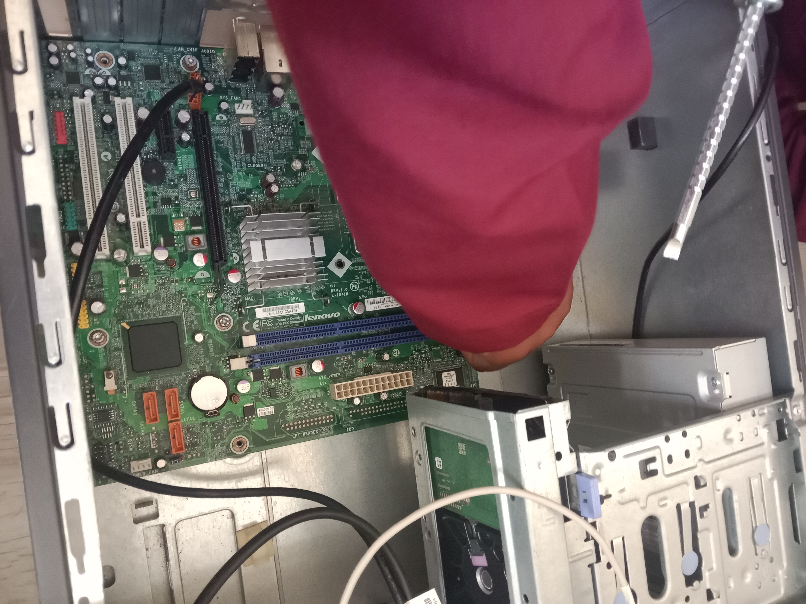
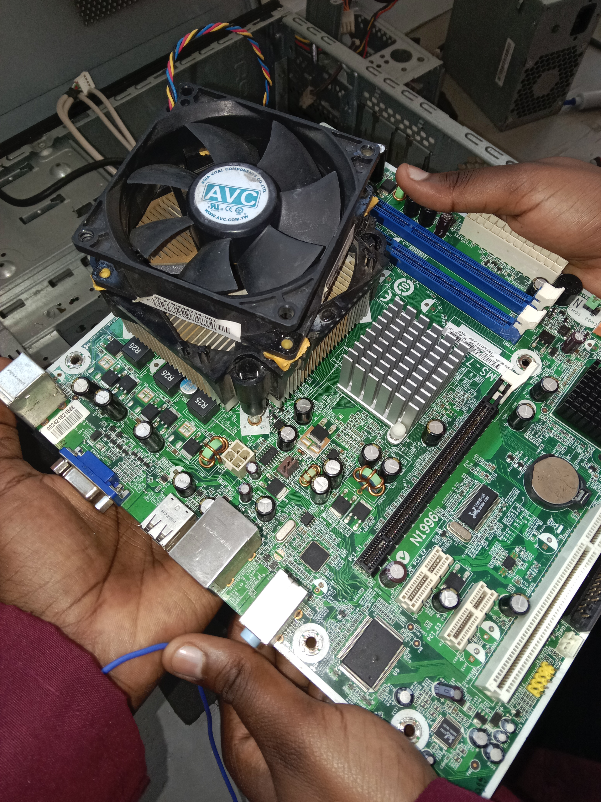
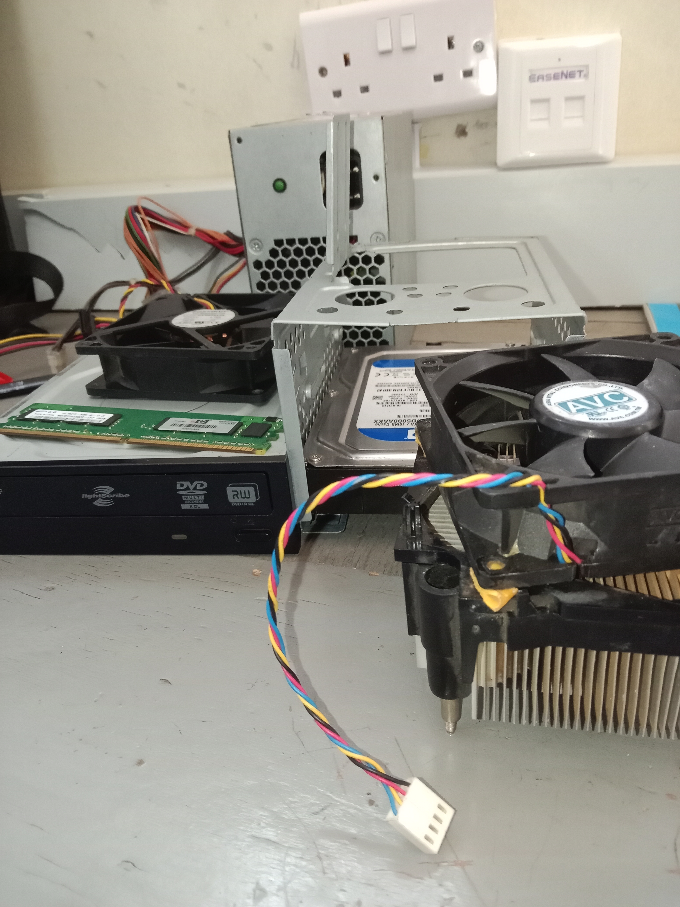
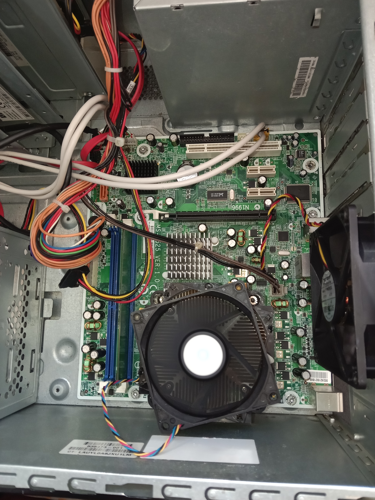

## 🛡️ Cyber Week Awareness Training — Ministry of Education & MICDE

I was honored to attend and represent my institution at the official Cyber Week Awareness Training, organized by the State Department for TVET and the Ministry of Information, Communications and the Digital Economy (Directorate of ICT Security & Audit Control).

---

### 📊 Key Technical Insights & Takeaways

#### 1. Kenya's Cyber Threat Landscape (KE-CIRT/CC Data)
* **11.12 Billion Total Threat Events** recorded up to June 2026, representing a 29% increase year-over-year.
* **4.56 Billion Peak Quarter (Oct–Dec 2025)**: Driven by weak patching, low phishing awareness, and AI-enabled cybercrime.
* **2.36 Billion Threats in Q2 2026**: Equating to approximately 18,000 threat events detected per minute.
* **Primary Threat Vectors**: Ransomware, Phishing, DoS/DDoS, Email Compromise, Data Breaches, Insider Threats, and AI Cybercrime (including deepfakes and automated attacks).

#### 2. The AI Cybersecurity Equation (Huawei Framework)
* **AI for Attackers**:
  * Automated reconnaissance and more convincing phishing.
  * Scaled social engineering and deepfake impersonation.
  * Faster attack development and adaptable malicious content.
* **AI for Defenders**:
  * Threat detection and anomaly identification.
  * Security analytics and investigation support.
  * Automation, incident response, and pattern recognition.

#### 3. Personal Security Practices & Fundamentals
* **Account Protection**: Implementing strong, unique passwords, 2-Step Verification (2SV), and avoiding insecure public Wi-Fi.
* **Phishing Mitigation**: Utilizing the **Stop ➔ Think ➔ Check ➔ Act** framework.
* **Digital Footprint Awareness**: Safeguarding online reputation under the principle that "what goes online stays online".
* **CIA Triad Core Objectives**: Confidentiality, Integrity, and Availability.
* **Extended Detection and Response (XDR)**: Malware and threat detection, monitoring suspicious activity, and vulnerability management.

---

### 🎓 Huawei Certification & Competition Pathways

#### Certification Tiers
* **HCIA** (Huawei Certified ICT Associate)
* **HCIP** (Huawei Certified ICT Professional)
* **HCIE** (Huawei Certified ICT Expert)
* **Core Tracks**: Datacom, Security, Cloud, AI, openEuler, Storage, and 5G.

#### Huawei ICT Competition
* **Tracks**: Practice Competition (Network, Cloud, Computing) and Innovation Competition (AI Innovation).
* **Progression Pipeline**: Registration ➔ Preliminary Rounds ➔ National Final ➔ Regional Final (South Africa) ➔ Global Final (China).

---

### 🚀 Building Kenya's Next Cyber Defenders
* Core institutional focus areas include innovation, research, responsible technology use, ethical hacking competitions, and campus cybersecurity clubs.
* 
### 📸 Session Photos & Slide References

#### 1. Registration & Event Overview
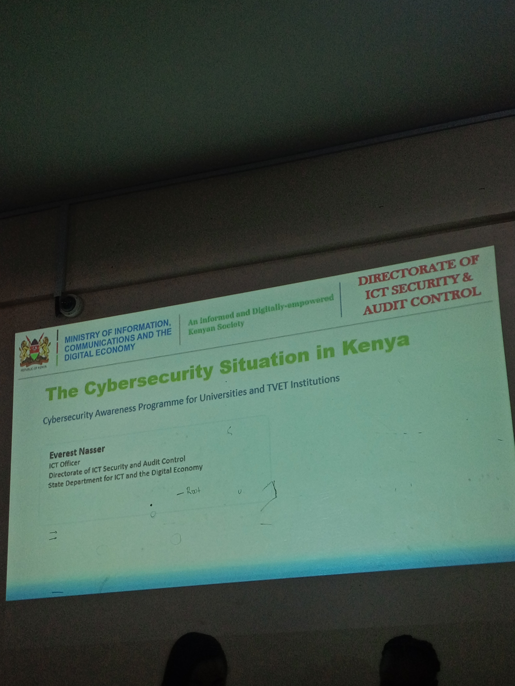
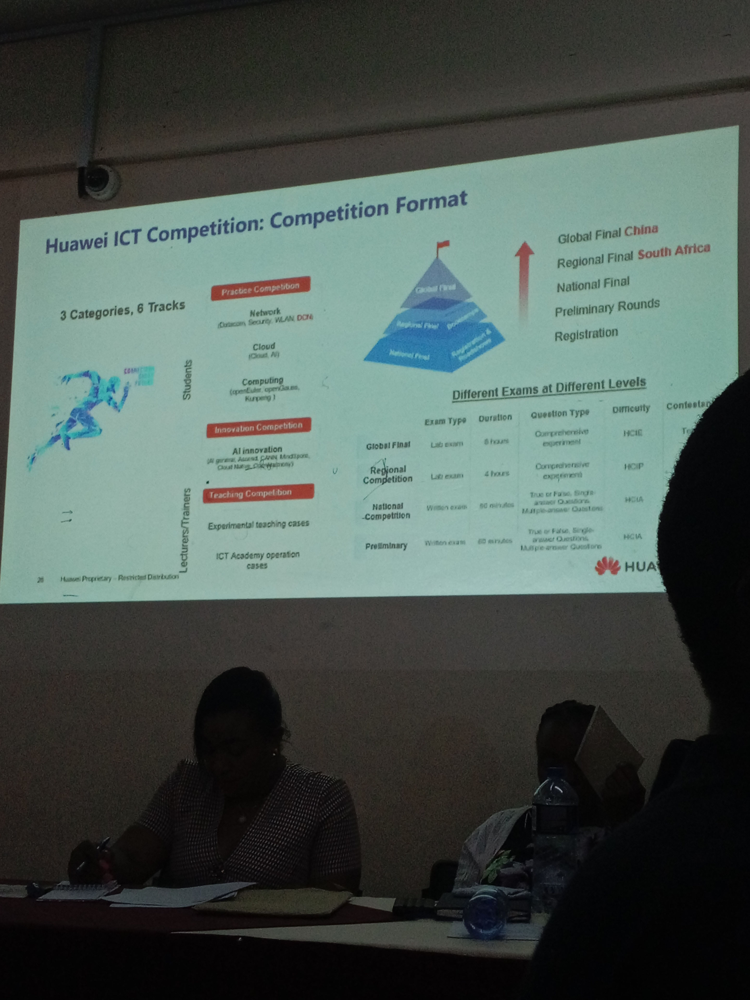

#### 2. Threat Statistics & Situation in Kenya
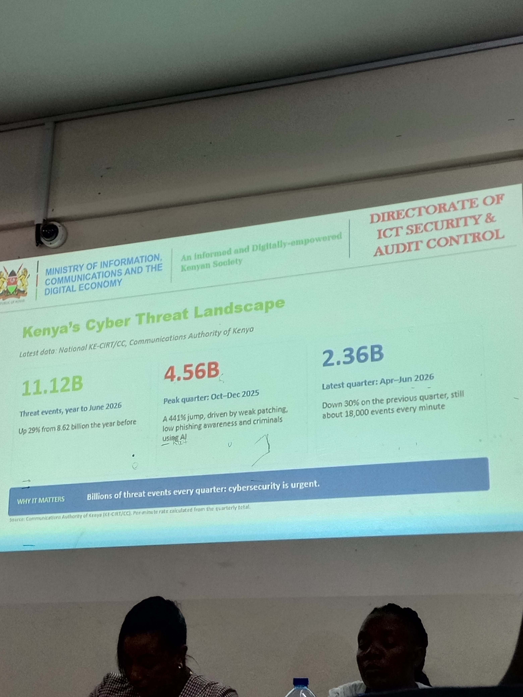
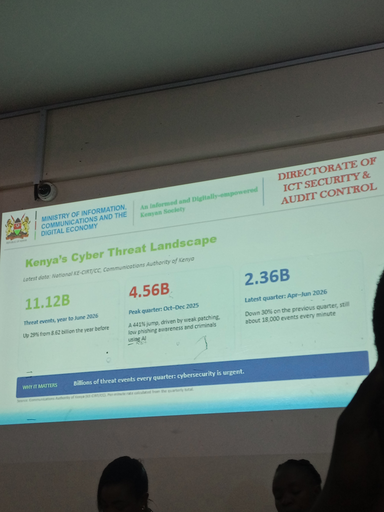
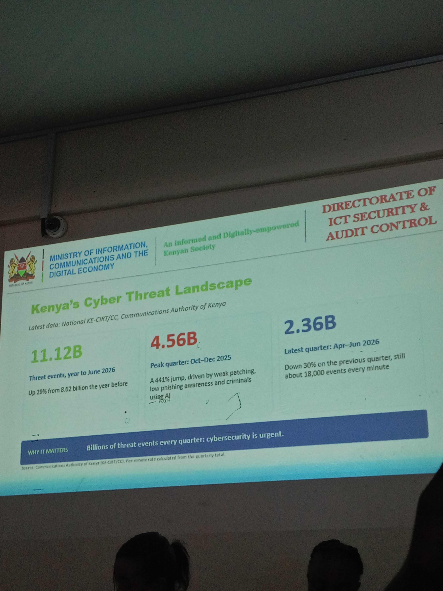

#### 3. AI Framework & Industry Certifications
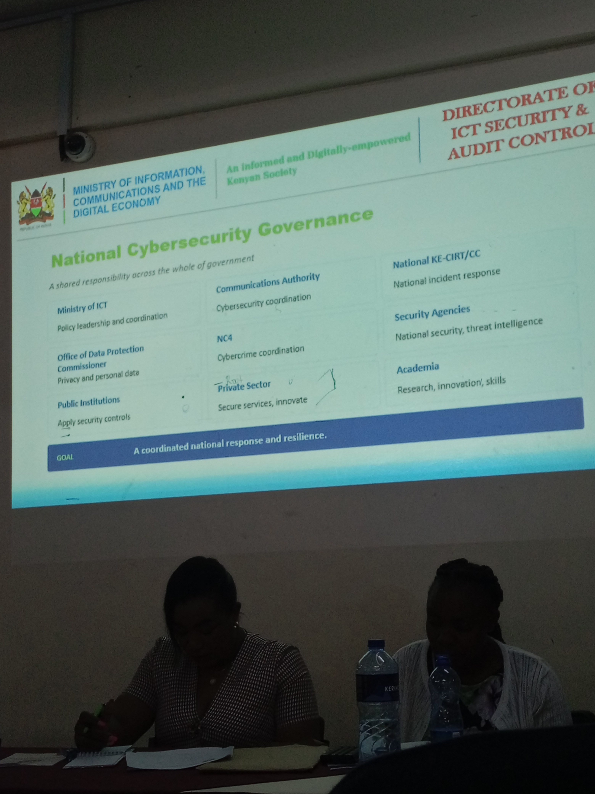
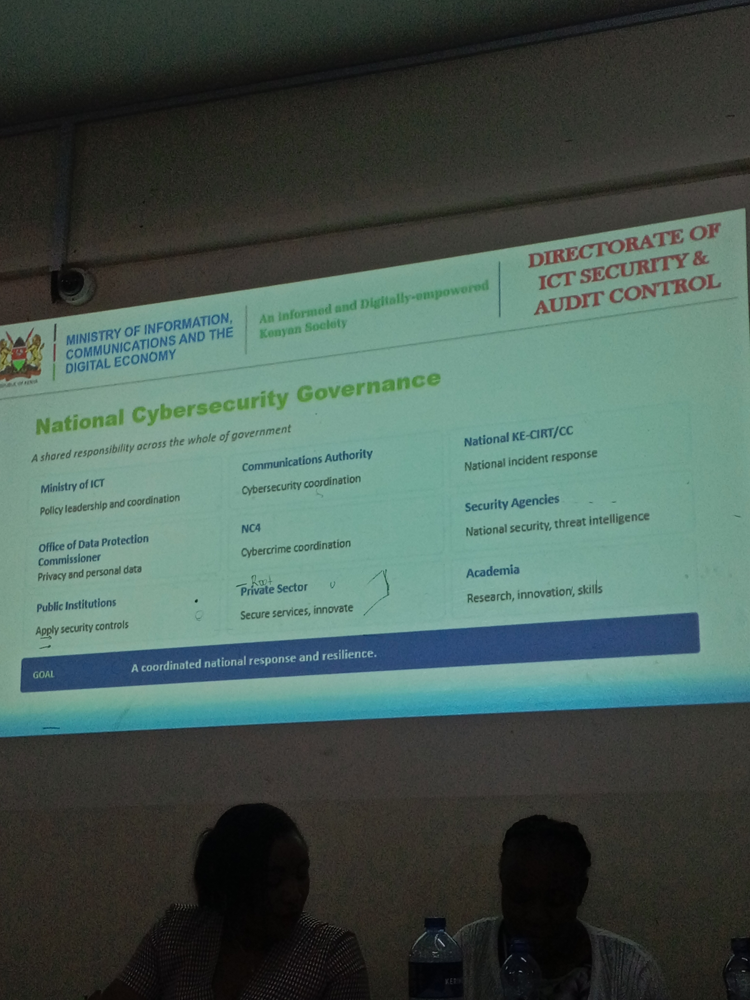

#### 4. Future Defenders
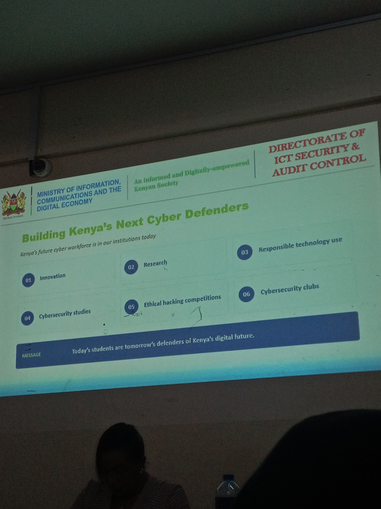
# Cisco Networking Academy: Career Pathways & Technical Skills Overview

> **Statement of Participation:**  
> I had the distinct honor of attending the technical forum **"Unlocking Career Opportunities through Cisco Certifications"** hosted at **WOTE TTI**. This document summarizes the comprehensive insights, technical skill sets, certification pathways, and industry-aligned career trajectories acquired during the session.

---

## 📌 Forum Overview & Key Takeaways

The session detailed how the **Cisco Networking Academy** (founded in 1997) serves as a global leader in ICT education, having trained over 3.3 million students across 56 African countries and partnering with institutions in over 180 countries globally.

### Why Cisco Skills Matter
* **Industry Leadership:** Cisco is a global leader and synonymous with network infrastructure, ensuring that skills acquired remain relevant and in high demand.
* **High Global Demand:** Certified professionals are sought after globally for their verified expertise.
* **Universal Language of IT:** Skills gained through Cisco are recognized as a universal language in the IT industry, opening doors to diverse career paths worldwide—from Nairobi to Silicon Valley.
* **Hands-On & Real-World Alignment:** Emphasizes practical, hands-on learning through tools like **Cisco Packet Tracer** and **Real Hardware Labs**, mapping directly to current industry job roles.
* **Institutional Support:** Supported by key partners like the **African Advanced Level Telecommunications Institute (AFRALTI)** (a Cisco Academy Support Center and Instructor Training Center since 2002).

---

## 🛣️ Cisco Certification Pathways Hierarchy

Cisco certifications validate technical expertise across four distinct progression levels:

| Level | Level Name | Focus & Target Certifications |
| :---: | :--- | :--- |
| **01** | **Entry Level** | Foundational certifications designed for newcomers to IT: • **CCST Networking** • **CCST Cybersecurity** • **CCST IT Support** |
| **02** | **Associate Level** | Core skills for specific IT roles: • **CCNA** (Cisco Certified Network Associate) • **CyberOps Associate** • **DevNet Associate** |
| **03** | **Professional Level** | Advanced expertise in specialized networking and security domains: • **CCNP Enterprise** • **CCNP Security** |
| **04** | **Expert Level** | The pinnacle of Cisco certifications, recognized globally for top-tier expertise: • **CCIE** (Cisco Certified Internetwork Expert) |

---

## 🎯 Detailed Career Tracks & Acquired Skill Sets

### 1. Networking Career Path 🌐
* **Course Modules & Acquired Knowledge:**
  * **CCNA 1: Introduction to Networks** – Foundational networking concepts, protocols, and architectures.
  * **CCNA 2: Switching, Routing & Wireless Essentials** – Advanced switching, routing protocols, and wireless network configuration.
  * **CCNA 3: Enterprise Networking** – Network security, automation, troubleshooting, and enterprise-level solutions.
* **Target Certification:** Cisco Certified Network Associate (CCNA).
* **Target Career Roles:**
  * Network Technician
  * Network Engineer
  * Network Security Engineer
  * Systems Administrator

---

### 2. Cybersecurity Career Path 🛡️
* **Course Modules & Acquired Knowledge:**
  * **Introduction to Cybersecurity** – Foundational security principles and threat awareness.
  * **Cybersecurity Essentials** – Core concepts, cryptography, and defense strategies.
  * **Network Defense & Endpoint Security** – Protecting network infrastructure and host endpoints from cyber attacks.
  * **Cyber Threat Management** – Threat monitoring, analysis, incident response, and mitigation.
* **Target Certifications:** CyberOps Associate, Ethical Hacker credentials.
* **Target Career Roles:**
  * Junior Cybersecurity Analyst
  * SOC (Security Operations Center) Analyst
  * Security Specialist
  * Penetration Tester

---

### 3. Programming & Software Development Path 💻
* **Course Modules & Acquired Knowledge:**
  * **Python Essentials 1 & 2** – Mastering foundational and advanced Python programming concepts.
  * **JavaScript Essentials 1 & 2** – Building interactive, modern web applications with JavaScript.
  * **C / C++ Essentials** – Learning powerful systems-level programming languages.
  * **HTML Essentials** – Structuring web content using standardized HTML markup.
* **Target Certifications:** PCEP, PCAP, JSE, CPE credentials.
* **Target Career Roles:**
  * Junior Developer
  * Software Developer
  * Web Developer
  * Application Engineer

---

### 4. Linux & IT Support Career Path 🐧
* **Course Modules & Acquired Knowledge:**
  * **IT Essentials** – Comprehensive introduction to computer hardware, software, networking, and technical troubleshooting.
  * **Linux Essentials** – Fundamentals of Linux operating systems, navigation, and command-line operations.
  * **Linux 1 & Linux 2** – Advanced Linux administration, system scripting, network service management, and security.
* **Target Certifications:** LPIC-1, CompTIA A+.
* **Target Career Roles:**
  * IT Support Specialist
  * Help Desk Technician
  * IT Administrator / Systems Analyst

---

## 🛠️ Practical Application Tools
* **Cisco Packet Tracer:** Network simulation and topology design.
* **Physical Hardware Labs:** Equipment rack configuration, routing/switching CLI setups, and cable patching.
* 
